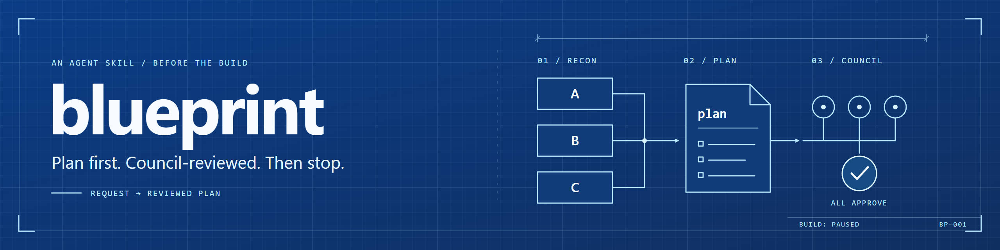

<p align="center"></p>

# blueprint

An agent skill that turns a request into a **reviewed, phased plan**, then stops before anything gets built.

Say `blueprint` to your coding agent. It researches, asks you only the questions that matter, writes one plan file, gets it reviewed by a council of models from different providers, and hands it back.

> **Status: experimental.** This is a development version. The workflow is reviewed, but it hasn't had many real runs yet. Expect changes.

## Why

Agents build faster than people can check. Most bad builds start as a bad plan: a wrong assumption, a missed requirement, a phase nobody can verify. blueprint puts the effort before the code:

- **Research first,** so questions are informed and facts aren't asked.
- **Only real decisions go to you,** one at a time, each with a recommendation.
- **Independent review** from three providers, with a hard round limit.
- **A hard stop.** Planning never turns into building by accident.

## How it works

```
intake ─▶ recon ─▶ interview ─▶ plan ─▶ council ─▶ hand-off
          A code     ledger      phases   3 rounds    stop
          B docs     decisions   checks   max
          C deep research (you approve the questions)
```

1. **Intake.** Goal, done-when, out of scope. Picks the level: one plan, or an initiative map of epics.
2. **Recon.** Delegates in parallel. A reads the codebase (if there is one). B checks libraries and APIs. C runs deep research only when it could change a decision, and only after you approve its 3-5 questions.
3. **Interview.** One sourced assumptions ledger, then load-bearing questions one per message. "Yes" takes the recommendation. "Accept all remaining recommendations" ends it.
4. **Plan.** One markdown file with requirement ids, decisions with sources, and phases. Each phase has files, steps, and an exact check.
5. **Council.** Three reviewers from different providers. APPROVE or REVISE, blocker / should / nit. Every member must approve the same revision. Max 3 rounds; deadlocks come back to you.
6. **Hand-off.** The plan path, the phases, and the review record. Nothing is built.

More detail: [docs/how-it-works.md](docs/how-it-works.md).

## Install

blueprint is a folder with a `SKILL.md`. Copy `skills/blueprint` into your agent's skills folder:

| Agent | Folder |
|---|---|
| Claude Code | `~/.claude/skills/blueprint` |
| Codex | `~/.agents/skills/blueprint` |
| Cursor | `~/.cursor/skills/blueprint` |
| OpenCode | `~/.config/opencode/skills/blueprint` |
| Antigravity | `~/.gemini/antigravity/skills/blueprint` |

It also needs the [`council`](https://github.com/t3dotgg/tstack/tree/main/skills/council) skill. Full setup: [docs/getting-started.md](docs/getting-started.md).

## Use

```
blueprint: add offline sync to the notes app
```

Outputs:

- `docs/plans/<date>-<slug>.md`: the plan (or `-initiative.md` for a map)
- `docs/research/<date>-<slug>.md`: the research brief, only when deep research ran

To build, start a new request: "build phase P1 of docs/plans/…".

## Configure

Recon models come from [`roster.yaml`](skills/blueprint/roster.yaml). By default every delegate uses your own model. See [docs/roster.md](docs/roster.md).

## Research

Two research rounds (26 delegates) and five council review rounds shaped this skill. What was decided, what was rejected, and why: [docs/research/](docs/research/README.md).

## Credits

blueprint's text is original. The ideas come from:

- [claudex-loop](https://github.com/chaseai-yt/claudex-loop) by chaseai-yt: the interview, plan, and plan-review workflow.
- [tstack](https://github.com/t3dotgg/tstack) by Theo Browne: the `council` skill blueprint calls, and `sol-loop`'s review discipline.
- [BMAD-METHOD](https://github.com/bmad-code-org/BMAD-METHOD): initiatives and epics, and just-in-time detail.
- [mattpocock/skills](https://github.com/mattpocock/skills): grilling, tracer-bullet slices.
- Anthropic, OpenAI, and Google published guidance on planning and deep research. See [docs/research/sources.md](docs/research/sources.md).

## License

[MIT](LICENSE)
